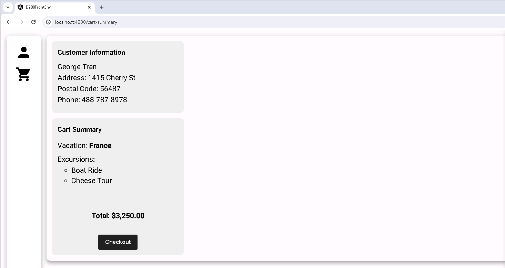
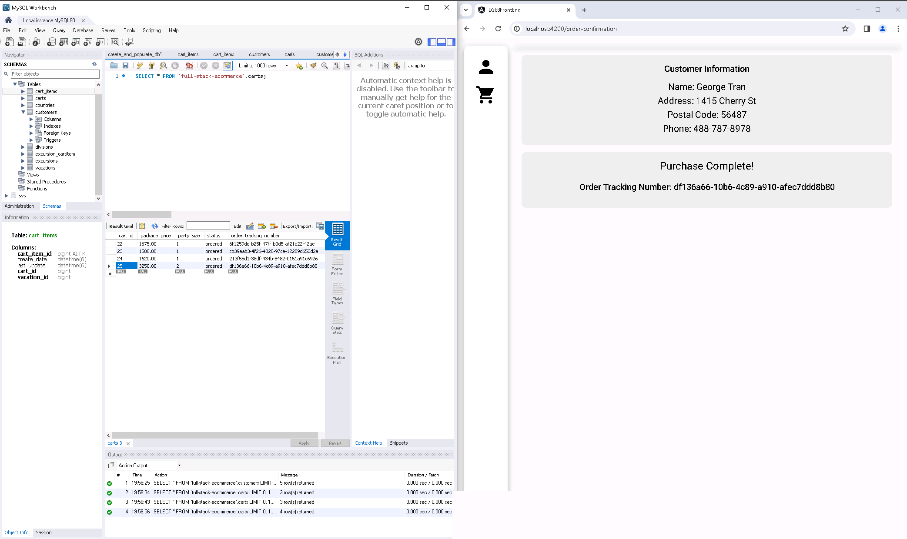

# Vacation Booking API

A Spring Boot REST back end for a vacation booking application. Customers browse vacation packages and optional excursions, build a cart, and check out to receive an order tracking number. Designed to be consumed by an Angular front end running on `http://localhost:4200`. 

Built as the back-end project for **WGU D288 Back-End Programming** course

## Tech stack

- Java 21, Spring Boot 3.3
- Spring Data JPA (Hibernate) with MySQL
- Spring Data REST for the catalog endpoints
- Lombok
- Maven (wrapper included)

## What it does

- **Catalog:** exposes vacations, excursions, countries, divisions (states/provinces) and customers as REST resources under `/api`.
- **Checkout:** `POST /api/checkout/purchase` accepts a customer, cart and cart items, generates a UUID order tracking number, marks the cart `ordered`, links everything together and saves it in a single transaction.
- **Sample data:** on startup, `BootStrapData` seeds a handful of sample customers if the customers table has fewer than six rows.

### Data model

- A `Country` has many `Division`s, and a `Division` has many `Customer`s.
- A `Customer` has many `Cart`s, and a `Cart` has many `CartItem`s.
- A `CartItem` points to one `Vacation` and to any number of `Excursion`s (many-to-many).
- A `Vacation` has many `Excursion`s.
- A `Cart` has a status of `pending`, `ordered` or `canceled`.

### Checkout example

```http
POST /api/checkout/purchase
Content-Type: application/json
```

The request body contains `customer`, `cart` and `cartItems`. The response looks like:

```json
{ "orderTrackingNumber": "3f6c1c8e-6d3b-4c55-9a43-1b1f2a5e8d10" }
```

## Demo

The API running end to end with the course-provided Angular front end (not included in this repository).


Browsing the vacation catalog, which the front end loads from this API. Next, a seeded sample customer books a France vacation with two excursions, and checkout completes without network errors.



The order confirmation page (right) shows the tracking number returned by the API, which matches the `order_tracking_number` of the new `ordered` row in the `carts` table in MySQL Workbench (left).



## Getting started

### Prerequisites

- JDK 21
- MySQL 8 running locally

### Database

The schema is not created by the application (`spring.jpa.hibernate.ddl-auto=none`), so the tables and reference data must exist before you start it:

- Database: `full-stack-ecommerce`
- Tables: `countries`, `divisions`, `customers`, `vacations`, `excursions`, `carts`, `cart_items`, `excursion_cartitem`
- `countries`, `divisions`, `vacations` and `excursions` need to contain data. The startup seeder looks up an existing division, so `divisions` must not be empty.

### Configuration

Connection settings are read from environment variables:

| Variable | Default | Notes |
| --- | --- | --- |
| `DB_URL` | `jdbc:mysql://localhost:3306/full-stack-ecommerce?...` | JDBC URL |
| `DB_USERNAME` | `ecommerceapp` | |
| `DB_PASSWORD` | none | required |

### Run

```bash
export DB_PASSWORD=your-password
./mvnw spring-boot:run
```

The API is then available at `http://localhost:8080/api`, for example `http://localhost:8080/api/vacations`.

### Test

```bash
./mvnw test
```

The included test is a Spring context smoke test, so it needs the database above to be running.

## Project layout

```
src/main/java/com/d288/tngu928/
├── bootstrap/     startup data seeding
├── config/        Spring Data REST configuration (exposed IDs, paging)
├── controllers/   checkout endpoint
├── dao/           Spring Data JPA repositories
├── dto/           Purchase request / PurchaseResponse
├── entities/      JPA entities and the cart status enum
└── services/      checkout business logic
```

## Possible improvements

- Add request validation and error handling to the checkout flow (empty carts, missing customer).
- Restrict the Spring Data REST endpoints that the front end does not need (there is a `TODO` for this in `RestDataConfig`).
- Add authentication.
- Ship a schema/seed script and use an in-memory database for tests so the project runs with no setup.
